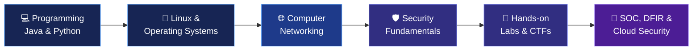

<!--
  GitHub Profile README: Saurav Sherkar
  Create a repo named exactly like your GitHub username, add this file as README.md.
  Replace: YOUR_GITHUB_USERNAME, YOUR_LINKEDIN_USERNAME, YOUR_EMAIL, SHOWROOMWALA_REPO_LINK
-->

<div align="center">


<a href="https://git.io/typing-svg">
  
</a>

<br/>

</div>

---

## 👨‍💻 About Me

I'm **Saurav Sherkar**, a Computer Engineering student pursuing my **B.Tech** through **Direct Second Year (DSE)** admission at **Sinhgad Institute of Technology, Lonavala**.

I'm passionate about understanding how technology works, how systems communicate, and, most importantly, how they can be **protected**. My primary career interest is **Cybersecurity**, and I'm working towards becoming a well-rounded security professional.

I believe in learning concepts from the fundamentals, practising them in real environments, and improving continuously through hands-on projects.

```java
public class SauravSherkar {

    String name       = "Saurav Sherkar";
    String education  = "B.Tech - Computer Engineering";
    String college    = "Sinhgad Institute of Technology, Lonavala";
    String admission  = "Direct Second Year (DSE)";
    String focus      = "Cybersecurity & Computer Engineering";
    String learning   = "Linux, Networking, Security Fundamentals";
    String goal       = "Become a skilled Cybersecurity Professional";

    String[] interests = {
        "Cybersecurity & Information Security",
        "Network Security",
        "Linux & Operating Systems",
        "Ethical Hacking Concepts",
        "Programming & Problem Solving",
        "Building Practical Projects"
    };

    public String mindset() {
        return "Learn the fundamentals. Practise consistently. Keep building.";
    }
}
```

---

## 🎯 My Cybersecurity Journey

Cybersecurity is more than ethical hacking. I want to understand the broader security field and develop the skills needed to **identify, analyse, prevent, and respond** to security issues.

| Area | What I'm Exploring |
|:-----|:-------------------|
| 🔵 **Networking** | Network fundamentals, protocols, ports, IP addressing and communication |
| 🐧 **Linux** | Commands, file systems, permissions and command-line usage |
| 🛡️ **Information Security** | CIA triad, authentication, authorization, access control and risk concepts |
| 🔍 **Security Operations** | SOC workflows, monitoring and incident-response fundamentals |
| ☁️ **Future Learning** | Cloud security, Digital Forensics & Incident Response (DFIR), security engineering |

> 💡 I'm currently in the learning and foundation-building stage. I aim to demonstrate skills through practical labs and projects rather than claim expertise prematurely.

### 🗺️ Learning Roadmap



---

## 🛠️ Tech Stack & Tools

### 💻 Programming & Development


### 🔐 Cybersecurity & Operating Systems


### ⚙️ Developer Tools & Platforms


### 📚 Core Computer Engineering Subjects

<table>
  <tr>
    <td>☕ Object-Oriented Programming (OOP) with Java</td>
    <td>🧮 Data Structures and Algorithms</td>
  </tr>
  <tr>
    <td>🗄️ Database & Data Warehousing Fundamentals</td>
    <td>🖥️ Operating Systems</td>
  </tr>
  <tr>
    <td>🌐 Computer Networks</td>
    <td>📐 Engineering Mathematics & Problem Solving</td>
  </tr>
</table>

<sub>Tech stack note: badges represent technologies and tools I use, have studied, or am currently learning. I'm continuously expanding this list as I gain practical experience.</sub>

---

## 🚀 Projects & Practical Work

| Project | Description | Focus |
|:--------|:------------|:------|
| 🏬 **[Showroomwala](SHOWROOMWALA_REPO_LINK)** | A showroom-focused web platform project | Web development, UI and platform features |
| 🧪 **Cybersecurity Labs** | Personal practice environment using Kali Linux and VirtualBox | Linux, networking and security fundamentals |
| ☕ **Java Practice** | Academic and self-practice programs covering OOP and programming fundamentals | Java, OOP and problem solving |

> 📌 Project links and detailed write-ups will be added as repositories are published.

---

## 🧪 My Home Lab

<details>
<summary><b>Click to expand my lab setup</b></summary>

<br/>

| Component | Details |
|:----------|:--------|
| **Hypervisor** | Oracle VirtualBox |
| **Attacker / Practice VM** | Kali Linux |
| **Purpose** | Safe, isolated environment to practise Linux, networking and security concepts |
| **Practice Areas** | Command line, file permissions, network scanning concepts, traffic basics |

> ⚠️ All practice is done in my own isolated lab environment or on platforms that explicitly permit it. Ethical and legal use only.

</details>

---

## 📖 Currently Learning

- ☕ Strengthening Java programming and OOP concepts
- 🐧 Practising Linux commands and working in Kali Linux
- 🌐 Revising computer networking fundamentals
- 🛡️ Learning core information-security principles and terminology
- 🔬 Building practical cybersecurity knowledge through labs and guided exercises
- 🌍 Improving web-development and Git/GitHub workflow skills

### 📈 Progress Tracker

| Skill | Progress |
|:------|:---------|
| Java & OOP |  |
| Linux Fundamentals |  |
| Computer Networking |  |
| Security Fundamentals |  |
| Git & GitHub |  |

<sub>Progress bars are honest self-estimates of where I am today. Adjust the numbers as you grow.</sub>

---

## 🧭 Goals

- [ ] Build strong foundations in networking, Linux, programming and operating systems
- [ ] Develop practical skills across defensive and offensive security concepts
- [ ] Learn how security teams monitor, investigate and respond to threats
- [ ] Create documented labs and projects that demonstrate real progress
- [ ] Practise on beginner-friendly platforms such as TryHackMe, Hack The Box and OverTheWire
- [ ] Work towards an entry-level certification such as CompTIA Security+ or Google Cybersecurity Certificate
- [ ] Grow into a capable cybersecurity professional

---

## 📊 GitHub Statistics

<div align="center">


<br/>


<br/>


</div>

---

## 📫 Connect With Me

<div align="center">

[](https://github.com/SauravSherkar)
[](mailto:sauravsherkar18@gmail.com)
[](https://www.linkedin.com/in/saurav-sherkar-b521672a8?utm_source=share_via&utm_content=profile&utm_medium=member_android)
[](https://instagram.com/saurav_sherkar_18)

</div>

<br/><br/>

> *"The future holds what the past never could."*

**Stay curious. Keep learning. Build with purpose. Secure with knowledge.** 🔐


</div>
